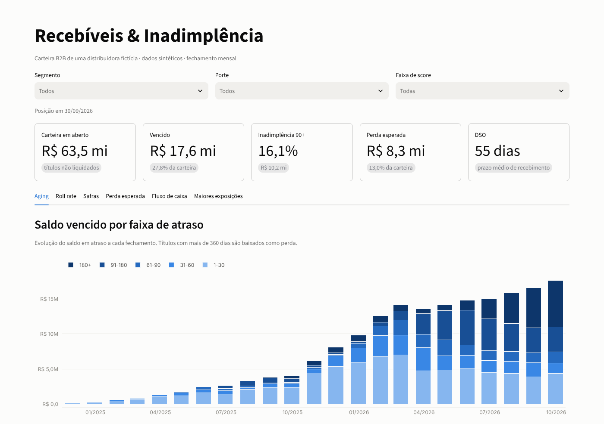
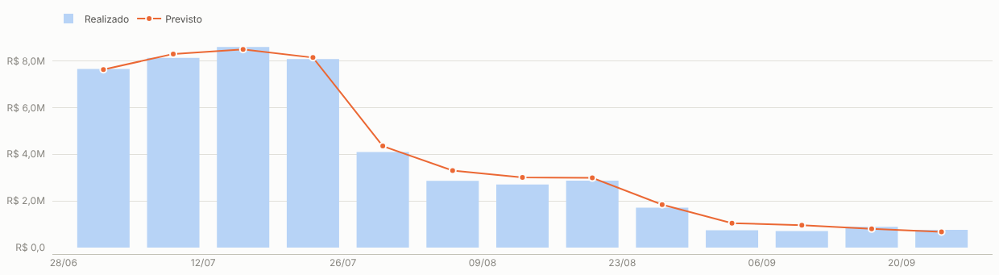
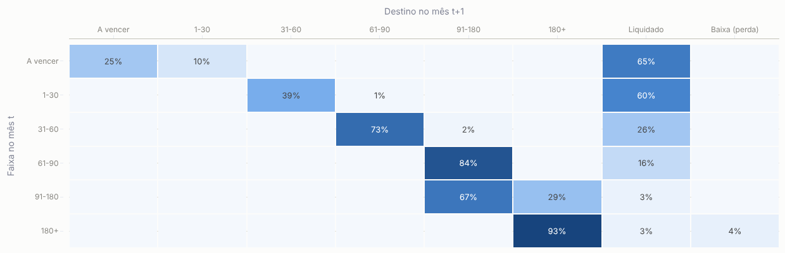
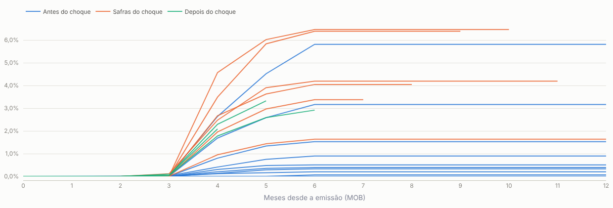

# Gestão de Recebíveis & Inadimplência para PMEs

> **Quanto do meu contas a receber vai virar caixa e quanto vai virar perda?**
> Este projeto responde isso para uma distribuidora B2B: pipeline de dados + métricas de crédito + painel interativo.



## O problema

Empresas que vendem a prazo (distribuidoras, indústrias, atacados) costumam acompanhar o contas a receber em
planilhas. O resultado é sempre o mesmo: ninguém sabe ao certo **quanto está realmente em risco**, a inadimplência só
é percebida quando já está alta e a previsão de caixa é feita "no feeling".

## O que este projeto entrega

| Pergunta do negócio | Como o projeto responde |
|---|---|
| Quanto tenho a receber e quanto está atrasado? | **Aging** mensal por faixa de atraso (1-30, 31-60, 61-90, 91-180, 180+) |
| A inadimplência está piorando? | **Roll rate**: % do saldo que piora de faixa a cada mês |
| As vendas recentes são de pior qualidade? | **Curva de safras** (vintage): % de cada mês de venda que chega a 90+ dias de atraso |
| Quanto devo provisionar para perdas? | **Perda esperada** via cadeia de Markov sobre a matriz de roll rate |
| Quanto vai entrar no caixa nas próximas semanas? | **Previsão de recebimento** de 13 semanas, **validada por backtest** |
| De quem depende a minha carteira? | **Concentração** dos maiores devedores |

Tudo pode ser filtrado por **segmento, porte e faixa de score** do cliente.

### Resultados na base de exemplo

- Carteira de **R$ 63,5 mi**, com **16,1%** em atraso acima de 90 dias.
- **Perda esperada de R$ 8,3 mi (13% da carteira)**: R$ 5,7 mi concentrados nos títulos com mais de 90 dias.
- A previsão de caixa, testada como se estivéssemos 13 semanas atrás, errou **3,5%** no total recebido.
- As safras de out–dez/2025, que venceram durante o choque econômico simulado, chegam a **até 6,5% do valor em
  atraso 90+**. As safras de abr–ago/2025 ficaram abaixo de 1%.

## Destaques técnicos

**Previsão de caixa com backtest**: para cada faixa de score, o modelo aprende a distribuição empírica de "dias de
atraso até pagar" (incluindo a chance de nunca pagar). Cada título em aberto recebe essa distribuição *condicionada*
ao atraso que já acumulou. A função só usa dados disponíveis até a data de corte, o que permite o backtest sem
vazamento de informação.



**Perda esperada por cadeia de Markov**: a matriz de roll rate média é tratada como uma cadeia com dois estados
absorventes (liquidado e baixa). A matriz fundamental `N = (I − Q)⁻¹` dá a probabilidade de cada faixa terminar em
perda. É o mesmo raciocínio de provisão usado por bancos e FIDCs, aplicado à carteira de uma PME.



**Curvas de safra (vintage)**: mostram se a qualidade das vendas piorou, separando o efeito do tempo de vida de cada
safra.



## Arquitetura

```
ERP (CSV) ──► bronze ──► silver ──────────────► gold ──────────────► Painel Streamlit
              CSVs       dim_cliente            aging, roll rate,     (filtros, abas)
              brutos     fato_titulo            safras, fluxo   ───► Parquet p/ Power BI
                         fato_snapshot (foto
                         mensal da carteira)
```

- **DuckDB** como motor analítico (roda local, sem servidor) e **SQL** puro nas transformações (`sql/`).
- **Regras de qualidade** que interrompem o pipeline se houver título sem cliente, duplicidade ou datas inválidas.
- Camada **gold exportada em Parquet**: pode ser plugada direto no Power BI ou no Looker.
- **Testes automatizados** (pytest) e **CI** no GitHub Actions.

```
gestao-recebiveis-pme/
├── src/recebiveis/
│   ├── gerar_dados.py   # base sintética realista (clientes, títulos, pagamentos)
│   ├── etl.py           # orquestra bronze → silver → gold + checagens de qualidade
│   └── metricas.py      # aging, roll rate, Markov, safras, previsão de caixa
├── sql/                 # transformações silver e gold
├── app/dashboard.py     # painel Streamlit
├── tests/               # testes de integridade e das métricas
└── docs/                # imagens do README
```

## Como rodar

**Com Python 3.10+**
```bash
pip install -e ".[dev]"
python -m recebiveis.gerar_dados   # cria a base sintética em data/bronze
python -m recebiveis.etl           # gera data/recebiveis.duckdb e data/gold/*.parquet
streamlit run app/dashboard.py     # abre em http://localhost:8501
```
Ou simplesmente `make setup dados etl app`.

**Com Docker**
```bash
docker build -t recebiveis .
docker run -p 8501:8501 recebiveis
```

**Testes**: `pytest -q`

## Usando com dados reais

O pipeline espera três arquivos em `data/bronze/`, no formato que qualquer ERP exporta:

| Arquivo | Colunas |
|---|---|
| `clientes.csv` | cliente_id, razao_social, segmento, porte, uf, score_bureau, limite_credito, data_cadastro |
| `titulos.csv` | titulo_id, cliente_id, data_emissao, data_vencimento, parcela, total_parcelas, valor |
| `pagamentos.csv` | pagamento_id, titulo_id, data_pagamento, valor_pago |

Basta substituir os CSVs sintéticos pelos exportados do ERP (Bling, Omie, Tiny, TOTVS, SAP etc.), ajustar
`DATA_CORTE` em `src/recebiveis/config.py` e rodar o ETL.

## Sobre os dados

Os dados são **100% sintéticos**, gerados por `gerar_dados.py`. Nenhum dado real de pessoa ou empresa é usado. O
gerador simula 1.500 clientes PME ao longo de 24 meses, com risco ligado ao score, ao segmento e a um choque
macroeconômico, para que as métricas mostrem padrões realistas.

## Autor

**Vitor Hugo Santos**: analista de crédito e dados (política de crédito, curvas de risco, NPV de carteira).
Faço projetos de **dashboards financeiros, automação de relatórios e integração de dados** para empresas.

[LinkedIn](https://www.linkedin.com/in/SEU-PERFIL) · [Workana](https://www.workana.com/freelancer/SEU-PERFIL)

---
Licença MIT
